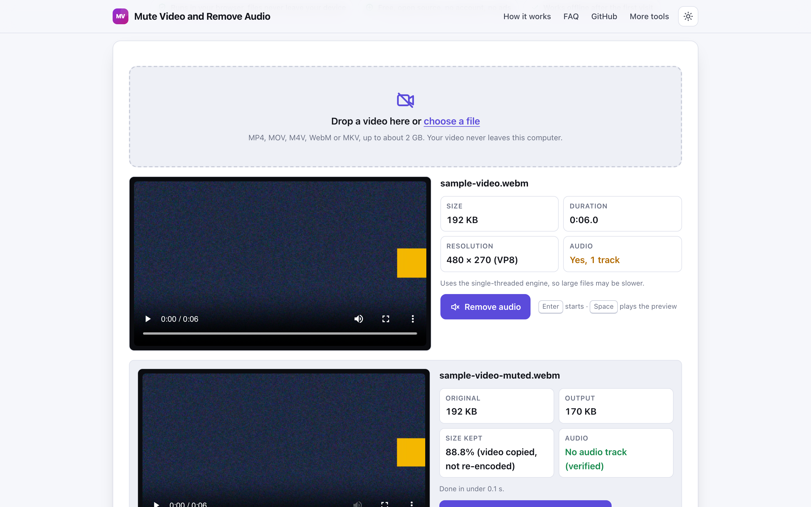
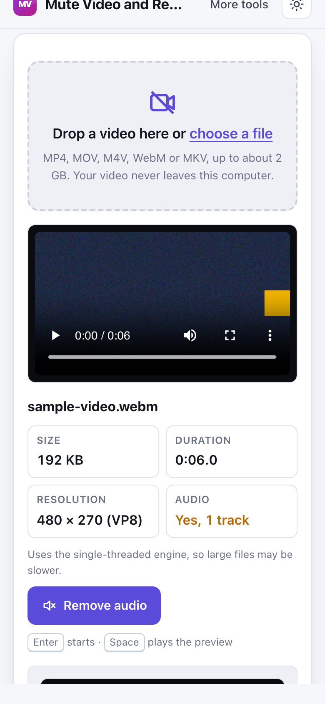

# Mute Video and Remove Audio

> Strip the sound from a video in your browser without re-encoding, with no watermark and no upload.

**🌐 Use it now: [turhe123.github.io/mute-video-remove-audio](https://turhe123.github.io/mute-video-remove-audio/)** · free · open source · runs in your browser · works offline


## Why

This is a free, open-source alternative to Clideo Mute Video and Kapwing Remove Audio from Video, which upload your video to their cloud, add a watermark to free exports, limit file size and ask you to sign up to remove the watermark. Here your files never leave the device, there is no account, no ads and no usage limits, it works offline, and you can install it as an app.

## Screenshots

<p align="center"></p>

<p align="center"><em>Mute Video and Remove Audio in the browser, light theme</em></p>

<p align="center"></p>

<p align="center"><em>Mute Video and Remove Audio on a phone</em></p>

## Features

- Removes every audio track from a video by copying the video stream untouched into a new file (stream copy, no re-encoding), so there is no quality loss and it is fast.
- No watermark on the output.
- Shows the detected duration, resolution, video codec and whether the file has an audio track (and how many).
- Preview player for the original and for the muted result. If the browser cannot play a format (for example iPhone HEVC), the download still works.
- Result card with original size, output size and the percentage kept, plus a check that the output has no audio track left.
- Download is named like the original with `-muted` added (`holiday.mp4` becomes `holiday-muted.mp4`); Unicode names are preserved.
- Subtitle tracks are kept when the container allows it; if copying them fails, the tool retries with video only and tells you. Data tracks such as timecode are dropped. Rotation metadata is preserved.
- Progress bar while the engine loads and runs; the ffmpeg core (about 32 MB) loads only after you choose a file.
- An informational note if the video already has no audio.
- Clear error messages for unsupported or damaged files, files that are not videos, files that are too large, and out-of-memory failures.
- Keyboard use: Enter starts, Space plays the preview.
- Light and dark themes, usable at 390 px wide, installable as a PWA.

**Input formats:** MP4, MOV, M4V, WebM, MKV (one video at a time).
**Output:** the same container and extension as the input.
**Limits:** the result is built in browser memory, so about 2 GB is the ceiling and there is a warning above 500 MB. Phones, especially Safari on iPhone, may fail sooner. The single-threaded ffmpeg build is used (GitHub Pages cannot send the headers the multi-threaded one needs), so large files are slower than in desktop apps.

## How to use

1. Open the page and drop a video onto the drop zone, or choose a file.
2. Check the info card: duration, resolution and whether there is an audio track.
3. Press **Remove audio** (or Enter) and wait for the progress bar to finish.
4. Play the silent result in the preview, compare the sizes, then press **Download**.

## Privacy

- Nothing is uploaded. Your video is processed on your device by ffmpeg compiled to WebAssembly.
- No cookies.
- Page views are counted anonymously with [GoatCounter](https://www.goatcounter.com/) (cookieless, open source).
- After the first visit a service worker caches the page, so it works offline.

## Run it locally

```bash
git clone https://github.com/turhe123/mute-video-remove-audio
cd mute-video-remove-audio
python3 -m http.server 4173
```

Then open http://127.0.0.1:4173/. There is no build step.

## Tests

```bash
npm i -D @playwright/test && npx playwright install chromium
npx playwright test
```

## Third-party code

| Library | Version | License | Location |
| --- | --- | --- | --- |
| [ffmpeg.wasm](https://github.com/ffmpegwasm/ffmpeg.wasm) | 0.12.10 | MIT (core: LGPL-2.1) | `vendor/ffmpeg/` |

## Built with AI

Mute Video and Remove Audio was written by [Claude Code](https://claude.com/claude-code) inside an automated pipeline, from a plain-English spec. No code or assets from any commercial product were used; it is a clean-room implementation of a feature set, not a copy.

What that means in practice:

- The full source is in this repo under the MIT license. Read it before you trust it with your files.
- Everything runs in your browser. It makes no network requests except an anonymous, cookieless page-view count (GoatCounter); your files never leave the device.
- The page is tested headless in Chromium (Playwright) before every release, but it has had less human review than hand-written software. Bug reports and pull requests are welcome.

## Support ❤️

If this saved you a paid subscription, you can say thanks on [Ko-fi](https://ko-fi.com/leodavidai).

## More free web tools

Find more at [turhe123.github.io/web-tools](https://turhe123.github.io/web-tools/).

## License

MIT © Or Davidai Bachar
